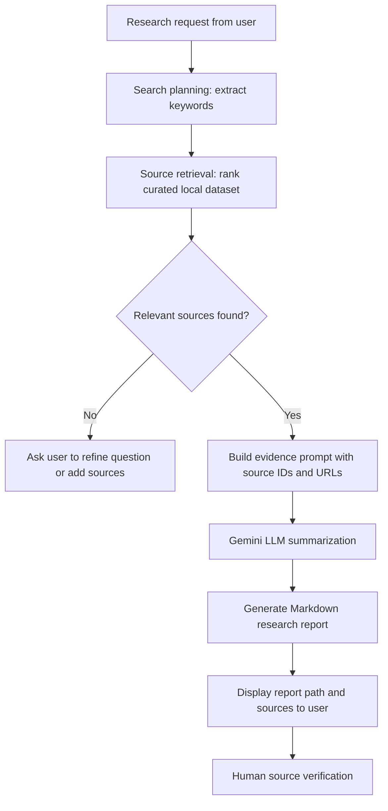

# Architecture

## Component responsibilities
- `app.py`: receives the research question and displays results.
- `research_agent.py`: controls the ordered workflow.
- `search_engine.py`: extracts keywords and ranks curated source entries.
- `summarizer.py`: sends retrieved evidence to Gemini and requests a source-grounded synthesis.
- `report_generator.py`: saves the report with source links and a verification warning.
- `dataset/sources.json`: curated source notes and metadata.
